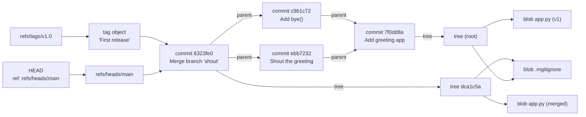
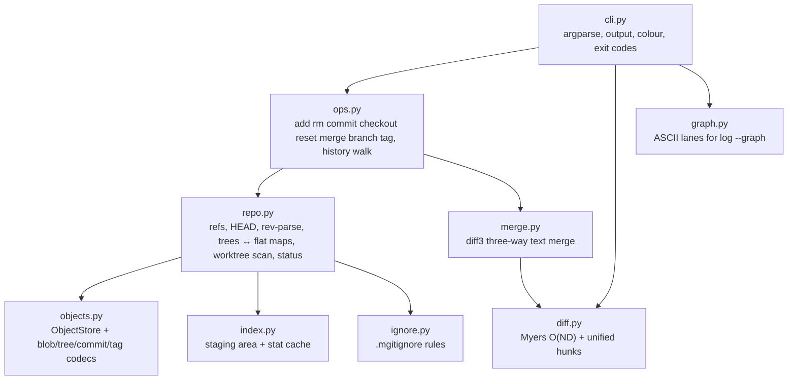

# mgit

A small version control system written from scratch in pure Python (standard library only). It
uses git's object model: content-addressed blobs, trees and commits, zlib-compressed and named by
their SHA-1. On top of that it has a staging area, branches and tags, a Myers line diff, and
three-way merges with conflict markers. You can install it with pip and use it as a real CLI.

The objects it writes are **byte-for-byte compatible with git's**. A test commits the same files
with mgit and with real git and checks that the tree and commit ids match.

```
$ mgit log --oneline --graph
* 6323fe0 (HEAD -> main) Merge branch 'shout' into main
|\
* | c9b1c72 Add bye()
| * ebb7232 (shout) Shout the greeting
|/
* 7f0dd8a Add greeting app
```

## Why build it

Most developers use git every day, but few could explain what happens on `git commit`. Building
one answers that, and it touches a surprising amount of computer science:

- **Content-addressed storage.** An object's name is the hash of its content. This gives you
  deduplication, integrity checks and cheap snapshots almost for free.
- **Merkle trees.** A commit id covers the entire project state. If one byte changes anywhere,
  the id changes. Unchanged subdirectories keep their ids, so a new commit only stores what
  actually changed.
- **Graph algorithms.** History is a DAG. `log` is a topological sort, `merge` needs the lowest
  common ancestor, and fast-forward is a reachability check.
- **Dynamic programming and edit distance.** The diff is Myers' O(ND) shortest-edit-script
  algorithm. The three-way merge (diff3) is built on top of it.
- **Defensive file-system programming.** Atomic writes, a stat cache with racy-timestamp
  handling, refusing to overwrite uncommitted or untracked work, and Windows/POSIX path
  differences.

## Features

| Area | What works |
|---|---|
| Object store | blob / tree / commit / annotated tag, `zlib(header + payload)`, SHA-1 ids, 2-char fan-out dirs, atomic writes, hash verified on every read, automatic deduplication |
| Staging | `add` files and directories (recursive, stages deletions), `.mgitignore` (globs, `**`, `dir/`, `/anchored`, `!negation`), `add -f` for ignored files, `rm` / `rm --cached` / `rm -r`, `reset -- <path>` to unstage |
| Inspection | `status` (long and `-s`), `log` (`--oneline`, `--graph`, `--all`, `-n`, `--first-parent`), `show`, `cat-file -t/-s/-p/-e`, `ls-files`, `hash-object` |
| Diff | working tree ↔ index, index ↔ HEAD (`--cached`), commit ↔ working tree, commit ↔ commit (`A B` or `A..B`), path filters after `--`, `--stat`, binary detection, coloured unified format |
| History | `commit` (with `--allow-empty`), `branch` (list/create/`-d`/`-D`/`-v`), `tag` (lightweight and `-a -m`), `checkout` (branch, commit/detached, `-b`, `-- <path>` to discard edits), `reset --soft/--mixed/--hard` |
| Merge | fast-forward, `--no-ff`, `--ff-only`, three-way line merge, conflict markers, modify/delete conflicts, resolve with `add` + `commit`, `merge --abort` |
| CLI | coloured output only on a TTY (`MGIT_COLOR=always/never`, `NO_COLOR`), `fatal:` + `hint:` messages, git-like exit codes, `mgit` console script and `python -m mgit` |

## Install

```bash
pip install .                 # installs the `mgit` command
python -m mgit --help         # or run it without installing
```

Requires Python 3.10+. No dependencies.

Identity comes from `MGIT_AUTHOR_NAME` / `MGIT_AUTHOR_EMAIL`, then `mgit config user.name "..."`,
then the OS user name. `MGIT_DATE="<unix seconds> <+hhmm>"` pins timestamps so commit ids are
reproducible.

## Example session

This is real output, captured from the installed `mgit` command with `MGIT_DATE` fixed (only
the repository path is shortened). You will get the same ids if you repeat it.

```console
$ mgit init
Initialized empty mgit repository in /tmp/demo/.mgit
$ printf 'def greet(name):\n    return "Hello " + name\n\n\nif __name__ == "__main__":\n    print(greet("world"))\n' > app.py
$ printf '*.log\n__pycache__/\n' > .mgitignore && echo noise > debug.log
$ mgit add .
$ mgit status
On branch main

No commits yet

Changes to be committed:
  (use "mgit reset -- <file>..." to unstage)
	new file:   .mgitignore
	new file:   app.py
$ mgit commit -m "Add greeting app"
[main (root-commit) 7f0dd8a] Add greeting app
 2 files changed
$ mgit checkout -b shout
Switched to a new branch 'shout'
$ sed -i 's/return "Hello " + name/return "HELLO " + name.upper()/' app.py
$ mgit diff
diff --mgit a/app.py b/app.py
index d049483..31339e0
--- a/app.py
+++ b/app.py
@@ -1,5 +1,5 @@
 def greet(name):
-    return "Hello " + name
+    return "HELLO " + name.upper()
 
 
 if __name__ == "__main__":
$ mgit add app.py && mgit commit -m "Shout the greeting"
[shout ebb7232] Shout the greeting
 1 file changed
$ mgit checkout main
Switched to branch 'main'
$ printf 'def bye(name):\n    return "Bye " + name\n' >> app.py
$ mgit commit -m "forgot to add"
fatal: nothing to commit, working tree matches HEAD
hint: use 'mgit add' to stage changes, or --allow-empty
$ mgit add app.py && mgit commit -m "Add bye()"
[main c9b1c72] Add bye()
 1 file changed
$ mgit merge shout
Auto-merging app.py
Merge made by the 'three-way' strategy: 6323fe0
$ mgit cat-file -p HEAD
tree dca1c5ab463c3edc6ed89758b4b5ba419175f216
parent c9b1c721c473db6a5486fd43fe352836a5880ab5
parent ebb7232337925baf355dc560c5ab54f02ae2554d
author Ada Lovelace <ada@example.com> 1763460000 +0200
committer Ada Lovelace <ada@example.com> 1763460000 +0200

Merge branch 'shout' into main
$ mgit tag -a v1.0 -m "First release"
$ echo '# local edit' >> app.py
$ mgit checkout shout
fatal: cannot switch branches: you have uncommitted changes (app.py)
hint: commit them, or discard them with 'mgit reset --hard'
```

Conflicts, and how to resolve them (both branches changed the same line):

```console
$ mgit checkout -- app.py && mgit checkout shout
$ sed -i 's/HELLO/HEY/' app.py && mgit add app.py && mgit commit -m 'Say hey'
[shout a759d86] Say hey
 1 file changed
$ mgit checkout main
$ sed -i 's/HELLO/GREETINGS/' app.py && mgit add app.py && mgit commit -m 'Say greetings'
[main 9b945ad] Say greetings
 1 file changed
$ mgit merge shout
CONFLICT (content): Merge conflict in app.py
Automatic merge failed; fix conflicts, 'mgit add' them, then 'mgit commit'.
$ head -6 app.py
def greet(name):
<<<<<<< HEAD (main)
    return "GREETINGS " + name.upper()
=======
    return "HEY " + name.upper()
>>>>>>> shout
$ mgit status
On branch main

You are in the middle of a merge (a759d86).
  (fix conflicts and run "mgit commit", or "mgit merge --abort")

Unmerged paths:
  (use "mgit add <file>..." to mark resolution)
	both modified:   app.py
$ # ...edit app.py...
$ mgit add app.py && mgit commit
[main 6613248] Merge branch 'shout' into main
 1 file changed
```

## Architecture

### Object model



Commits point at a root tree and at their parents. Trees point at blobs and subtrees. Refs are
small files naming a commit, and `HEAD` names a ref. Every arrow is a SHA-1 of the target's
content, so the shared `.mgitignore` blob is stored once and reused by every commit.

### Layers



Everything below `cli.py` is a library: functions take a `Repository` and raise `MgitError`. The
tests exercise most behaviour without going through the CLI.

The byte-level formats are described in [docs/INTERNALS.md](docs/INTERNALS.md).

## Command reference

| Command | Description |
|---|---|
| `mgit init [dir] [-b branch]` | Create `.mgit/` (re-running is safe) |
| `mgit add <path>... [-f] [-v]` | Stage files; directories recursively; respects `.mgitignore`; stages deletions under the given path |
| `mgit rm <path>... [--cached] [-r] [-f]` | Unstage and delete (or keep with `--cached`) |
| `mgit status [-s]` | Staged / not staged / untracked / unmerged |
| `mgit commit -m <msg> [--allow-empty]` | Record the index; during a merge `-m` is optional |
| `mgit log [rev...] [--oneline] [--graph] [--all] [-n N] [--first-parent]` | History, newest first, parents never before children |
| `mgit diff` | Working tree vs index |
| `mgit diff --cached [rev]` | Index vs HEAD (or rev) |
| `mgit diff <rev>` | Commit vs working tree |
| `mgit diff <a> <b>` / `<a>..<b>` | Commit vs commit; add `-- <paths>` to filter, `--stat` for a summary |
| `mgit branch [-v]` · `branch <name> [start]` · `branch -d/-D <name>` | List / create / delete (refuses unmerged without `-D`) |
| `mgit checkout <branch\|rev> [-f]` | Switch (refuses if dirty); a non-branch rev gives a detached HEAD |
| `mgit checkout -b <name> [start]` | Create and switch |
| `mgit checkout [rev] -- <path>...` | Discard working-tree edits (from the index or a commit) |
| `mgit merge <rev> [-m msg] [--no-ff] [--ff-only]` · `merge --abort` | Fast-forward or three-way merge |
| `mgit reset [--soft\|--mixed\|--hard] [rev]` | Move the branch; `--mixed` also resets the index, `--hard` also the files |
| `mgit reset [rev] -- <path>...` | Unstage paths |
| `mgit tag [name [rev]] [-a -m msg] [-d name]` | List / lightweight / annotated / delete |
| `mgit show [rev] [--stat]` | Commit header + diff vs first parent; also tags, trees, blobs |
| `mgit cat-file (-t\|-s\|-p\|-e) <object>` | Low-level object inspection |
| `mgit ls-files [-s]` · `mgit hash-object [-w] <file>` · `mgit config <key> [value]` | Plumbing |

Revisions: `HEAD`, branch, tag, full or abbreviated id (≥ 4 hex), `ORIG_HEAD`, `MERGE_HEAD`,
with `~N` and `^N` suffixes (`HEAD~2`, `main^2`).

**Exit codes:** `0` success · `1` the command failed (unknown revision, dirty tree, merge
conflict...) · `2` bad command-line usage · `128` not inside a repository (the same code git
uses).

## Design decisions

- **Same object format as git, not a simplified one.** Using git's exact framing, tree sort
  order and commit layout makes correctness testable: the test suite compares ids with real git.
  It also means the knowledge carries over directly to git itself.
- **Loose objects only, no packfiles.** Each object is its own zlib file. This is simple and
  easy to inspect. Delta compression was left out on purpose (see limitations).
- **JSON index instead of git's binary index.** You can open `.mgit/index` and read what is
  staged. It keeps the same stat-cache idea, including racy-clean handling, so `status` does not
  re-hash unchanged files.
- **Myers diff written from scratch.** `difflib` is not used. Lines are interned to ints, common
  prefix and suffix are trimmed, and the result is property-tested against an LCS dynamic
  program for minimality.
- **diff3-style merge built on the same diff.** It finds sync points where both sides kept the
  base, and conflicts only when both sides changed the same region differently. An identical
  change on both sides is not a conflict.
- **Safe by default.** `checkout` and `merge` refuse when there are local changes, when a merge
  is in progress, or when an untracked file would be clobbered. Every ref and object write is
  atomic (temp file + `os.replace`). Object reads re-verify the hash.
- **Library first, CLI second.** `ops.py` returns data and raises typed errors, and `cli.py`
  only formats them. That kept the tests fast and the output easy to change.
- **Repo-relative POSIX paths everywhere internally.** Native paths are only used at the
  file-system boundary, which is why the same code passes on Windows and Linux.

## mgit vs git

| | mgit | git |
|---|---|---|
| Object format (blob/tree/commit/tag, SHA-1, zlib) | ✅ identical bytes and ids | ✅ |
| SHA-256 repositories | ❌ | ✅ (`--object-format=sha256`) |
| Storage | loose objects only | loose + packfiles with delta compression |
| Index | JSON, stat cache, racy-clean handling | binary, many extensions |
| Diff algorithm | Myers (from scratch) | Myers by default, plus patience/histogram/minimal |
| Merge | fast-forward, three-way diff3, modify/delete conflicts | recursive/ort strategies, rename detection, many options |
| Rename detection | ❌ | ✅ |
| `.gitignore` features | globs, `**`, `dir/`, anchoring, `!` (root file only) | full spec, nested ignore files, global excludes |
| Remotes, clone, fetch, push | ❌ | ✅ |
| Rebase, cherry-pick, stash, reflog, hooks, submodules | ❌ | ✅ |
| Symlinks | skipped | stored as links |
| Code size | about 2,500 lines of Python | hundreds of thousands of lines of C |
| Speed (1,000 files add+commit, Linux) | 106 ms | 104 ms (whole `init+add+commit`, incl. process start) |

## Measured performance

From `python bench/benchmark.py`. The script generates 1,000 deterministic source-like files
(2.6 MiB), times each operation in-process (median of 3 fresh repositories), measures the
object store on disk, and times real git on the same workload for reference.

**Linux (WSL2, Ubuntu, Python 3.14.4):**

| Operation | Result |
|---|---|
| `add` 1,000 files (hash + compress + write blobs, write index) | 96 ms |
| `commit` (build 162 tree objects + commit) | 10 ms |
| **add + commit 1,000 files** | **106 ms** |
| `status`, cold (racily-clean entries re-hashed) | 17 ms |
| `status`, warm (stat cache hit) | 8 ms |
| `add` + `commit` after editing 1% of files | 23 ms |
| `checkout` a branch where 10% of files differ | 23 ms |
| Myers diff, 10,000 lines with 100 scattered edits | 16 ms |
| Myers diff, 2,000 lines with 50% changed (near worst case) | 310 ms |
| Object store after first commit | 672 KiB in 1,162 objects |
| **Store size vs raw content** | **25.2%** |
| Second commit (1% of files edited): new objects / bytes | 32 / 10.5 KiB |
| Reference: real `git init && git add . && git commit` | 104 ms |

**Windows 11 (same machine, native Python 3.12.3):** add+commit took 10.8 s, warm `status`
270 ms, the 10k-line diff 59 ms. This number is dominated by the environment, not by mgit.
The benchmark includes a baseline row that just reads the same 1,000 freshly written files with
plain `open()`, and on this machine that alone took 7.4 s, because real-time antivirus scanning
of file opens by `python.exe` adds several milliseconds per file. Real git did the same job in
1.5 s on the same host. Run the script yourself; CI publishes its numbers in the job summary.

What the numbers show:

- **Compression and deduplication work.** The object store is a quarter of the raw size, and
  that already includes 162 tree objects and the commit.
- **Snapshots are cheap.** Every commit stores the full tree, but a commit that edits 10 files
  writes only 32 new objects: 10 blobs, the trees on their paths, and the commit.
- **The stat cache matters.** Warm `status` is about 2× faster than one that re-hashes every
  file, even on this small project.
- **Myers is O(ND).** A small edit in a large file is fast (16 ms for 10,000 lines). Cost grows
  with the number of differences, and the nearly-all-different case is the slow one.

## Tests

```bash
python -m unittest -v
```

**79 tests** cover:

- **Hashing.** Known git ids for blobs and the empty tree; determinism; type sensitivity.
- **Object store.** Round trips; on-disk layout; deduplication; corruption detection; prefix
  lookup.
- **Codecs.** Tree sort order, plus commit, tag and signature round trips.
- **Diff.** The Myers example from the paper (D = 5); 300 random cases checked for
  reconstruction and minimality against an LCS dynamic program; hunk grouping; ranges for
  new and deleted files; the no-newline marker.
- **diff3 merge.** Clean merges, identical changes, conflicts, insertions and deletions.
- **Ignore rules.** Globs, `dir/`, anchoring, negation, `**`; integration with `add` and
  `status`.
- **Repository.** Staging, status (including racy same-size edits), `rm` safety, unstaging,
  nested trees, `rev-parse` (`~`, `^`, short ids), reproducible commits, branches, checkout
  (switching, dirty refusal, untracked-clobber refusal, detached HEAD, restoring paths), all
  three reset modes, tags.
- **Merges.** Fast-forward, up-to-date, clean three-way merge with the right parents and merge
  base, conflict → resolve → commit, abort, modify/delete conflicts, dirty-tree refusal.
- **Git compatibility.** The same files produce the same tree **and commit** id as real git.
  Skipped automatically if git is not installed.
- **CLI end to end.** Output format, exit codes 0/1/2/128, every `diff` mode, binary files,
  conflict status `UU`, `log --graph`, `cat-file`, `show`, tags, `--`-separated paths, and
  `python -m mgit` in a subprocess.

CI (GitHub Actions) runs ruff, then the suite on **Ubuntu and Windows × Python 3.10 and 3.13**.
It then installs the package, smoke-tests the `mgit` console script (including
`mgit hash-object` == `git hash-object`), and runs the benchmark.

## Project structure

```
mgit/
  cli.py        argparse commands, git-style output, colours, exit codes
  ops.py        porcelain: add, rm, commit, checkout, reset, merge, branch, tag, history
  repo.py       plumbing: discovery, refs/HEAD, rev-parse, tree <-> flat map, worktree, status
  objects.py    object store + blob/tree/commit/tag serialisation
  index.py      staging area with stat cache
  diff.py       Myers diff + unified hunks
  merge.py      diff3 three-way text merge
  ignore.py     .mgitignore matcher
  graph.py      ASCII graph for log --graph
  color.py      TTY-aware ANSI colours (enables VT mode on Windows)
  errors.py     MgitError, exit codes
tests/          79 unittest tests, each in its own temp directory
bench/          benchmark.py (reproducible, prints a Markdown table)
docs/           INTERNALS.md: byte-level object, index and ref formats
```

## Limitations

- No packfiles or delta compression. Large histories of large files take more disk space than
  in git.
- No remotes (clone/fetch/push), rebase, cherry-pick, stash, reflog, hooks or submodules.
- No rename detection in diff or merge. A rename shows up as a delete plus an add.
- Only one `.mgitignore`, at the repository root. Nested ignore files and global excludes are
  not supported.
- Symlinks are skipped. Executable bits are recorded on POSIX only (always `100644` on Windows).
- No index locking, so two mgit processes must not write to the same repository at once.
- `log --graph` is a simple lane renderer. It draws forks and merges correctly for typical
  branch-and-merge histories, but does not draw every edge in complex histories the way
  `git log --graph` does.
- Myers diff keeps O(D²) memory for backtracking (fine for source files; git uses a
  linear-space variant).
- `show` on a merge commit diffs against the first parent instead of producing a combined diff.

## License

MIT, see [LICENSE](LICENSE).
